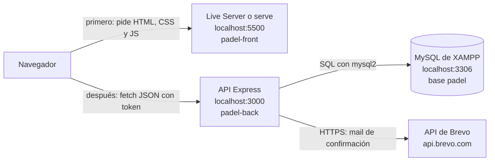
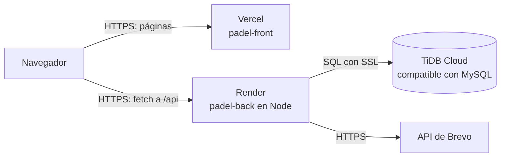
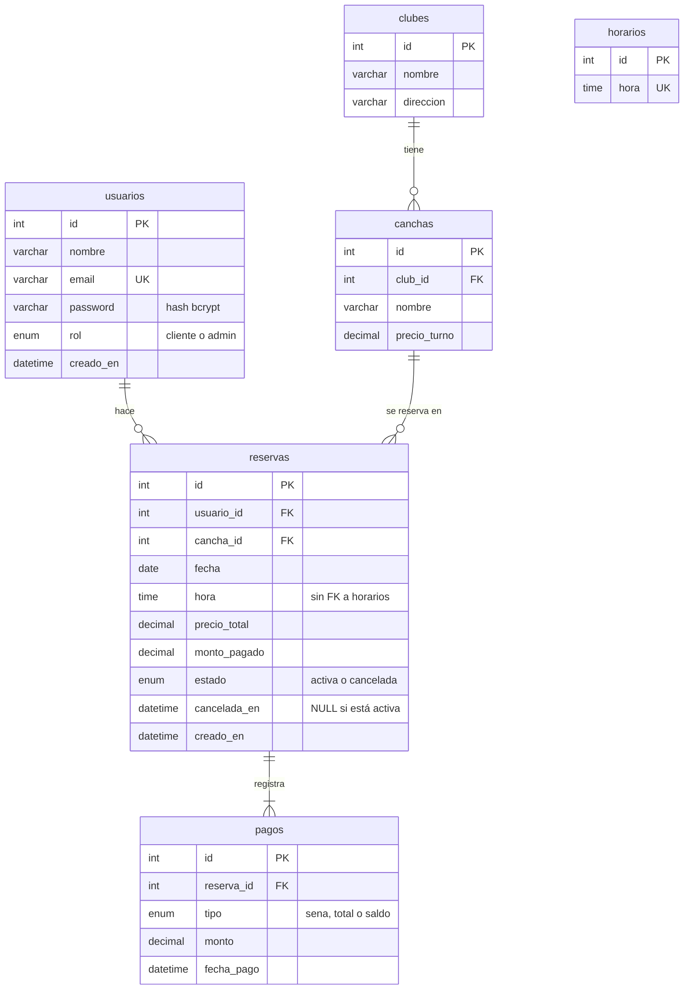
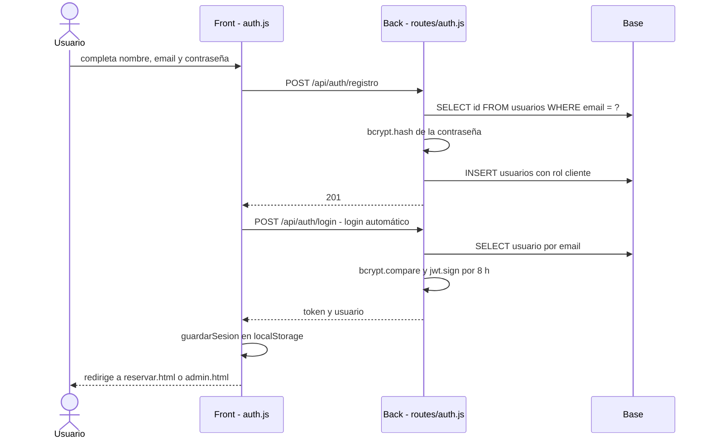
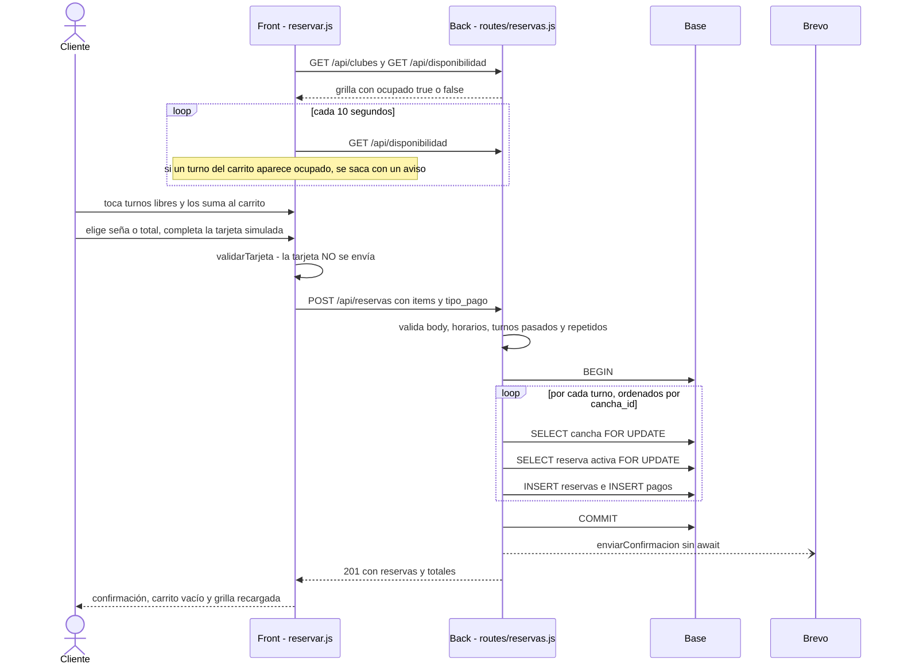
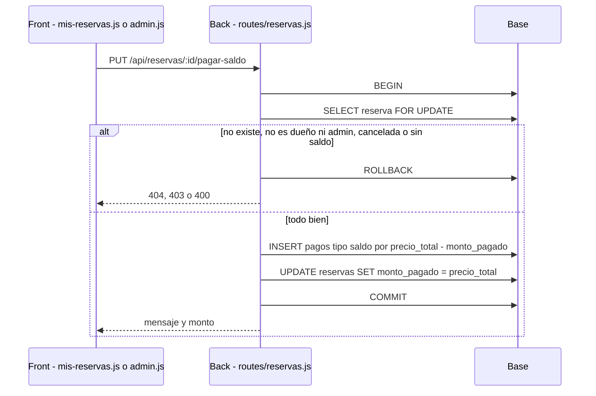
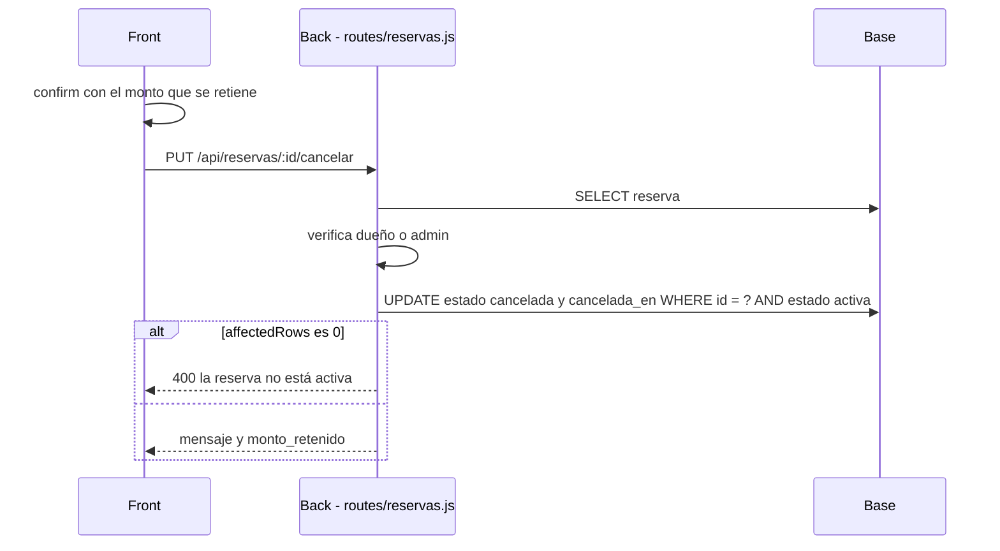
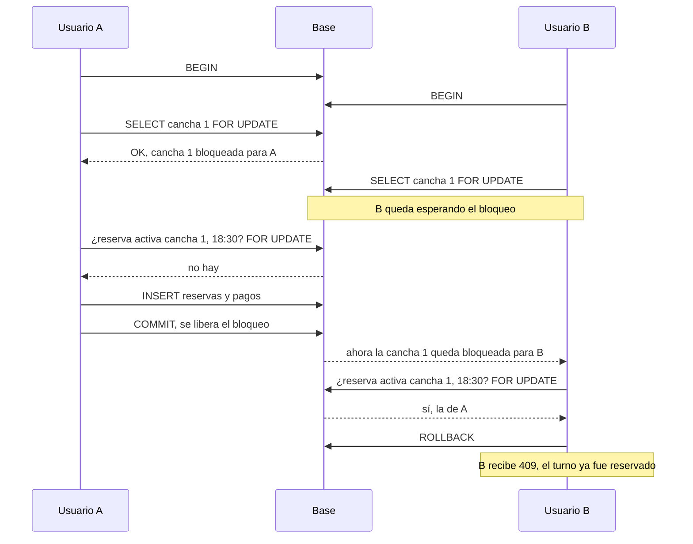

# Arquitectura – Sistema de Reservas de Canchas de Pádel

Documento técnico del proyecto. Describe qué hace cada parte, cómo se conectan y **por qué** se tomó cada decisión.
El código está en dos repositorios:

- **padel-back**: API REST en Node.js + Express + MySQL (este repo).
- **padel-front**: páginas en HTML, CSS y JavaScript puro → [github.com/MiaWaskievich/padel-front](https://github.com/MiaWaskievich/padel-front)

## Índice

1. [Resumen del sistema](#1-resumen-del-sistema)
2. [Arquitectura](#2-arquitectura)
3. [Conexiones entre componentes](#3-conexiones-entre-componentes)
4. [Variables de entorno](#4-variables-de-entorno)
5. [Modelo de datos](#5-modelo-de-datos)
6. [Endpoints](#6-endpoints)
7. [Flujos paso a paso](#7-flujos-paso-a-paso)
8. [Concurrencia](#8-concurrencia)
9. [Seguridad](#9-seguridad)
10. [Cómo levantarlo en local](#10-cómo-levantarlo-en-local)
11. [Pasaje a la web](#11-pasaje-a-la-web)
12. [Limitaciones y qué se haría en un sistema real](#12-limitaciones-y-qué-se-haría-en-un-sistema-real)
13. [Preguntas probables de la defensa](#13-preguntas-probables-de-la-defensa)

---

## 1. Resumen del sistema

Un cliente se registra, elige club y fecha, ve una grilla de turnos (canchas × horarios), arma un carrito con
uno o varios turnos y los paga (pago simulado) con **seña del 30 %** o **pago total**. Todo el carrito se
reserva en una sola transacción SQL, así nunca se reserva dos veces el mismo turno. Después recibe un mail de
confirmación. Desde "Mis reservas" paga el saldo o cancela (sin devolución).
El administrador ve la recaudación del día, las reservas del día, administra los horarios y crea otros admins.

| Requerimiento del enunciado | Cómo se resolvió | Archivos / endpoints |
|---|---|---|
| Gestión de usuarios con JWT | Registro (siempre rol `cliente`) y login. La contraseña se guarda con hash **bcrypt**; el login devuelve un **JWT** de 8 h que el front manda en cada petición. Roles `cliente` y `admin`. | `routes/auth.js`, `middleware/auth.js` · `POST /api/auth/registro`, `POST /api/auth/login` · front: `js/auth.js`, `js/api.js` |
| Grilla de turnos con bloqueo de ocupados | El back cruza canchas × horarios y marca `ocupado` si hay una reserva activa **o** si el horario ya pasó. El front la dibuja y la recarga cada 10 s. | `routes/clubes.js` · `GET /api/disponibilidad` · front: `js/reservar.js` |
| Carrito con pago total o seña, y transacciones SQL contra la doble reserva | El carrito vive en el front; al confirmar se manda entero. El back lo reserva en **una transacción** con `SELECT … FOR UPDATE` (todo o nada). | `routes/reservas.js` · `POST /api/reservas` |
| Saldo antes de jugar y sin devolución al cancelar | El saldo (`precio_total - monto_pagado`) se paga desde "Mis reservas" o lo cobra el admin. Al cancelar, `monto_pagado` queda igual: es el **monto retenido**. | `PUT /api/reservas/:id/pagar-saldo`, `PUT /api/reservas/:id/cancelar` · front: `js/mis-reservas.js`, `js/admin.js` |
| Mail de confirmación | Después del commit se manda un mail con el detalle usando la **API HTTP de Brevo**. | `utils/mailer.js`, `routes/reservas.js` |
| Panel administrativo con recaudación diaria | Dashboard por fecha: recaudado, pagos totales, señas, saldos, pendientes, retenidos e ingresos por cancha. También reservas del día, horarios y alta de admins. | `routes/admin.js` · `/api/admin/*` · front: `admin.html`, `js/admin.js` |

> **Aclaración sobre "saldo antes de jugar":** el sistema **avisa** (en "Mis reservas", en el carrito y en el mail)
> que el saldo debe estar pagado antes de usar la cancha, y muestra al admin qué reservas del día deben plata
> (`pendientes`). No hay un control automático en la cancha (por ejemplo, un check-in): eso lo hace el club.

---

## 2. Arquitectura

El sistema tiene tres piezas propias (front, back, base) y un servicio externo (Brevo).
El **navegador** descarga las páginas del servidor del front y después **llama directamente a la API**: el
servidor del front solo entrega archivos, no reenvía nada. Por eso front y back son dos orígenes distintos y
hace falta CORS (ver [sección 3](#3-conexiones-entre-componentes)).

### Local

### Web

### Tecnologías

| Tecnología | Dónde | Por qué se eligió |
|---|---|---|
| HTML + CSS + JavaScript puro | Front | Sin frameworks ni build: todo el código se puede leer y explicar línea por línea. |
| Node.js 18+ + Express | Back | JavaScript en los dos lados. Express es mínimo: rutas, middlewares y JSON. |
| mysql2/promise | Back | Driver de MySQL con `async/await` y **pool de conexiones**. Sin ORM, para escribir y entender el SQL (sobre todo la transacción). |
| MySQL (XAMPP) | Base local | Viene con XAMPP, se administra con HeidiSQL o phpMyAdmin. |
| TiDB Cloud | Base web | Compatible con MySQL (el mismo `schema.sql` y el mismo código) y tiene plan gratis. Exige SSL. |
| bcryptjs | Back | Hash de contraseñas con sal. Es JavaScript puro: no necesita compilar nada en Windows ni en Render. |
| jsonwebtoken | Back | Genera y verifica los JWT de la sesión. |
| cors | Back | Permite que solo el front autorizado llame a la API desde el navegador. |
| dotenv | Back | Lee el archivo `.env` y carga las variables en `process.env`. |
| nodemon (desarrollo) | Back | Reinicia el server al guardar un archivo (`npm run dev`). |
| Brevo (API HTTP) | Mails | Plan gratis y API por HTTPS, que funciona en Render (SMTP está bloqueado). Se llama con `fetch`, sin librerías. |
| Render | Hosting back | Corre Node gratis directamente desde el repo de GitHub. |
| Vercel | Hosting front | Sirve archivos estáticos gratis desde el repo de GitHub. |

---

## 3. Conexiones entre componentes

### Front → Back

- **`js/config.js`** define `API_URL` mirando el `hostname` de la página:
  si es `localhost` o `127.0.0.1` usa `http://localhost:3000/api`; si no, la URL de Render.
  Así el **mismo código** del front funciona en local y en la web sin tocar nada.
- **`js/api.js` → `apiFetch(ruta, opciones)`** hace **todas** las llamadas:
  - arma `API_URL + ruta` y agrega `Content-Type: application/json`;
  - si hay sesión, agrega `Authorization: Bearer <token>`;
  - si la respuesta es **401 y había token** (sesión vencida), borra la sesión y vuelve a `index.html`.
    Sin token, un 401 es "email o contraseña incorrectos" del login y se muestra como error normal;
  - si la respuesta no es OK, lanza un `Error` con el mensaje `{ error }` del back (y `error.status`, que
    `reservar.js` usa para reconocer el 409);
  - si `fetch` falla (back apagado, sin red, CORS), lanza `"No se pudo conectar con el servidor"`.
- **CORS** (`server.js`): el navegador solo deja que una página lea respuestas de **otro origen** si ese
  origen lo autoriza. El back acepta los orígenes listados en `FRONT_URL` (separados por coma) y también las
  peticiones sin `Origin` (curl, Postman). Cualquier otro origen recibe la respuesta sin headers CORS y el
  navegador la bloquea.

### Back → Base de datos

- **`db.js`** crea un **pool** de hasta 10 conexiones con `mysql.createPool` y los datos `DB_HOST`, `DB_PORT`,
  `DB_USER`, `DB_PASSWORD` y `DB_NAME`. Un pool reutiliza conexiones abiertas en vez de abrir una por petición.
  Las consultas comunes usan `pool.query(...)`; las transacciones piden una conexión propia con
  `pool.getConnection()` (todas las consultas de la transacción tienen que ir por **la misma** conexión).
- **`DB_SSL=true`** activa `ssl: { minVersion: 'TLSv1.2', rejectUnauthorized: true }`, que TiDB Cloud exige.
  En XAMPP es `false`.
- **`dateStrings: true`**: las fechas vuelven como texto (`'2026-11-08'`) y no como objetos `Date`, para evitar
  corrimientos por zona horaria. **`decimalNumbers: true`**: los `DECIMAL` vuelven como número.
- **Zona horaria**: la primera línea de `server.js` es `process.env.TZ = 'America/Argentina/Buenos_Aires'`.
  Render y TiDB trabajan en UTC, así que "ahora" se calcula en Node (`fechaHoy()` y `fechaHoraAhora()` de
  `utils/constantes.js`) y se inserta explícitamente. Nunca se usa `NOW()` ni `CURDATE()` de MySQL.

### Back → Brevo

- **`utils/mailer.js` → `enviarConfirmacion({ email, nombre, reservas, totales, tipo_pago })`** hace un
  `POST https://api.brevo.com/v3/smtp/email` con `fetch`, el header `api-key` y un timeout de 10 segundos
  (`AbortSignal.timeout(10000)`).
- **Por qué no SMTP:** Render en el plan gratis bloquea los puertos SMTP (**25, 465 y 587**), así que una
  librería como nodemailer por SMTP no podría conectarse. La API de Brevo va por **HTTPS (puerto 443)**, que
  nunca está bloqueado.
- Si falta `BREVO_API_KEY` o `MAIL_FROM`, no manda nada y solo muestra `Mail no enviado: falta configurar Brevo`.
  El sistema funciona igual sin mail.

---

## 4. Variables de entorno

**Idea central:** el **mismo código** corre en local y en la web; lo único que cambia son las variables de
entorno. En local se leen del archivo `.env`; en Render se cargan en el panel del servicio.

| Variable | Para qué sirve | Valor local | Valor en la web |
|---|---|---|---|
| `PORT` | Puerto donde escucha la API | `3000` | Lo asigna Render automáticamente |
| `DB_HOST` | Servidor de la base | `localhost` | Host de TiDB Cloud |
| `DB_PORT` | Puerto de la base | `3306` | El que indica TiDB (normalmente `4000`) |
| `DB_USER` | Usuario de la base | `root` | Usuario de TiDB |
| `DB_PASSWORD` | Contraseña de la base | *(vacía en XAMPP)* | Contraseña de TiDB |
| `DB_NAME` | Nombre de la base | `padel` | `padel` |
| `DB_SSL` | Conexión cifrada | `false` | `true` |
| `JWT_SECRET` | Clave con la que se firman los tokens | `cambiar_este_secreto` | Texto largo y aleatorio |
| `FRONT_URL` | Orígenes permitidos por CORS (separados por coma) | `http://127.0.0.1:5500,http://localhost:5500` | URL de Vercel |
| `BREVO_API_KEY` | Clave de la API de Brevo | La key de Brevo | La misma key |
| `MAIL_FROM` | Email remitente (verificado en Brevo) | `miawaskievich@gmail.com` | El mismo |
| `MAIL_FROM_NAME` | Nombre del remitente | `Padel Reservas` | `Padel Reservas` |

- **`.env` no se sube a git** (está en `.gitignore`): tiene contraseñas y claves. Si estuviera en GitHub,
  cualquiera podría usar la base o mandar mails con nuestra cuenta.
- **`.env.example` sí se sube**: tiene los **nombres** de las variables con valores de ejemplo o vacíos, para
  que quien clone el repo sepa qué configurar (`copy .env.example .env`).

---

## 5. Modelo de datos

| Tabla | Qué guarda | Detalles |
|---|---|---|
| `usuarios` | Clientes y administradores | `email` único. `password` es el hash bcrypt. `rol` por defecto `cliente`. |
| `clubes` | Los clubes | `nombre` y `direccion`. |
| `canchas` | Las canchas de cada club | FK `club_id`. `precio_turno` es el precio vigente del turno. |
| `reservas` | Un turno reservado | FK a usuario y cancha. `precio_total` copia el precio **del momento de la reserva** (si después cambia el precio de la cancha, la reserva no cambia). Índice `idx_cancha_fecha_hora (cancha_id, fecha, hora)` para buscar rápido si un turno está ocupado. |
| `pagos` | Cada movimiento de plata | Una fila por seña, pago total o pago de saldo, con su `fecha_pago`. |
| `horarios` | Horas de inicio de los turnos | `hora` única. La administra el admin. El seed carga 10 turnos de 90 min (08:00 a 21:30). |

El seed (`database/seed.sql`) carga 3 clubes, 7 canchas, los 10 horarios y el admin `admin@padel.com`.

### Decisiones

- **El saldo se calcula, no se guarda.** Saldo = `precio_total - monto_pagado`. Si se guardara en una columna,
  habría que mantenerlo sincronizado con las otras dos y podría quedar inconsistente. Calculado, siempre es correcto.
- **`pagos` es el libro de caja.** Cada vez que entra plata se inserta una fila (`sena`, `total` o `saldo`) con
  fecha y hora. El dashboard suma esta tabla por `fecha_pago` para saber cuánto se cobró **ese día**, aunque los
  turnos sean de otro día. `reservas.monto_pagado` es el acumulado de una reserva; `pagos` es el historial.
- **`horarios` no tiene FK con `reservas`.** `reservas.hora` es un `TIME` común. Si hubiera FK, borrar un horario
  obligaría a borrar o romper las reservas viejas de esa hora. Así, el horario deja de ofrecerse pero el
  historial queda intacto. (Para no dejar reservas futuras "huérfanas", el back no deja borrar un horario con
  reservas activas de hoy en adelante.)
- **Un turno es cancha + fecha + hora, y solo se guarda al reservarlo.** No hay una tabla con todos los turnos
  posibles: la grilla se arma en el momento cruzando canchas × horarios, y solo los reservados existen como filas
  en `reservas`. Por eso agregar un horario o una cancha no requiere generar datos.
- **El índice `(cancha_id, fecha, hora)` no es `UNIQUE`.** Una reserva cancelada sigue en la tabla con la misma
  cancha, fecha y hora; si el índice fuera único, ese turno nunca podría volver a reservarse. La unicidad entre
  reservas **activas** la garantiza la transacción (ver [sección 8](#8-concurrencia)).

---

## 6. Endpoints

Todas las respuestas son JSON. Los errores siempre tienen la forma `{ "error": "mensaje" }`.
Las rutas protegidas necesitan el header `Authorization: Bearer <token>`.

| Método | Ruta | Acceso | Qué hace |
|---|---|---|---|
| GET | `/` | Público | `{ mensaje: "API Pádel funcionando" }` (sirve para ver si el back está vivo). |
| POST | `/api/auth/registro` | Público | Crea un usuario **cliente** `{ nombre, email, password }`. 409 si el email existe. |
| POST | `/api/auth/login` | Público | `{ email, password }` → `{ token, usuario: { id, nombre, email, rol } }`. |
| GET | `/api/clubes` | Público | Clubes, cada uno con su array de canchas. |
| GET | `/api/disponibilidad?club_id=&fecha=` | Público | `{ fecha, horarios, canchas: [ { id, nombre, precio_turno, turnos: [ { hora, ocupado } ] } ] }`. |
| POST | `/api/reservas` | Cliente | Reserva el carrito `{ items: [ { cancha_id, fecha, hora } ], tipo_pago }` en una transacción. 201 con el detalle y los totales; 409 si algún turno ya está tomado. |
| GET | `/api/reservas/mias` | Logueado | Reservas del usuario con club, cancha, saldo y estado. |
| PUT | `/api/reservas/:id/pagar-saldo` | Dueño o admin | Paga el saldo (inserta un pago `saldo`). |
| PUT | `/api/reservas/:id/cancelar` | Dueño o admin | Cancela sin devolución; responde el `monto_retenido`. |
| GET | `/api/admin/dashboard?fecha=` | Admin | Resumen de caja del día (por defecto hoy). |
| GET | `/api/admin/reservas?fecha=` | Admin | `{ fecha, reservas }` con cliente, email, club, cancha, hora, montos y estado. |
| POST | `/api/admin/usuarios` | Admin | Crea un usuario **admin** `{ nombre, email, password }`. |
| GET | `/api/admin/horarios` | Admin | `[ { id, hora } ]` ordenados por hora. |
| POST | `/api/admin/horarios` | Admin | Agrega `{ hora: 'HH:MM' }`. 400 si el formato es inválido, 409 si ya existe. |
| DELETE | `/api/admin/horarios/:id` | Admin | Borra un horario. 409 si tiene reservas activas de hoy en adelante. |

Códigos usados: **400** datos inválidos · **401** sin token o token inválido · **403** rol sin permiso ·
**404** no existe · **409** conflicto (turno tomado, email o horario repetido) · **500** error inesperado.

---

## 7. Flujos paso a paso

### a) Registro y login

- **bcrypt** transforma la contraseña en un hash irreversible con sal (`bcrypt.hash(password, 10)`). En el login
  no se "desencripta": `bcrypt.compare` vuelve a calcular el hash y compara.
- El **JWT** contiene `{ id, nombre, email, rol }` y está **firmado** con `JWT_SECRET`. Si alguien lo modifica,
  la firma deja de coincidir y `jwt.verify` lo rechaza. Vence a las 8 horas.
- **Cómo viaja el token:** el front lo guarda en `localStorage` (`guardarSesion`) y `apiFetch` lo agrega en cada
  petición como `Authorization: Bearer <token>`. En el back, `verificarToken` lo valida y deja los datos en
  `req.usuario`; `soloRol(...)` revisa el rol.
- Para un login incorrecto (email inexistente o contraseña mal) se usa el mismo mensaje, así no se puede
  averiguar qué emails están registrados.

### b) Reserva completa

Detalle de lo que hace cada lado:

1. **Grilla** (`cargarGrilla` y `dibujarGrilla`): filas = horarios, columnas = canchas. Libre en verde,
   ocupado en gris (incluye horarios pasados), en el carrito en azul.
2. **Carrito** (variable `carrito` en `reservar.js`): puede tener turnos de distintos clubes y fechas. El resumen
   (`calcularResumen`) es solo una **estimación** con `PORCENTAJE_SENA`; los montos reales los calcula el back.
3. **Tiempo real** (`actualizar`, cada 10 s): `verificarCarrito` consulta la disponibilidad de **cada club/fecha
   del carrito** y saca los turnos que ahora están ocupados; después recarga la grilla.
4. **Pago simulado** (`validarTarjeta`): titular, 16 dígitos, `MM/AA` y CVV de 3 dígitos. Solo se valida el
   formato; los datos **no** se mandan al back.
5. **Transacción** (`POST /api/reservas`): ver [sección 8](#8-concurrencia). El precio sale **de la base**:
   seña = `Math.round(precio * 30 / 100)`, total = precio.
6. **Respuesta 201**: `reservas` (club, cancha, fecha, hora, precio_total, monto_pagado, saldo) y `totales`
   (total, abonado, saldo_pendiente). Si es **409**, el front muestra el mensaje y llama a `actualizar()` para
   sacar del carrito lo que ya no está libre.
7. **Mail**: se manda después del commit, sin esperar la respuesta de Brevo.

### c) Pagar saldo

El `FOR UPDATE` sobre la reserva evita que un doble clic (o el cliente y el admin a la vez) paguen el saldo dos veces.

### d) Cancelar

- **No hay devolución:** `monto_pagado` queda igual y pasa a ser el **monto retenido**. No se inserta ningún pago negativo.
- **El horario se libera solo:** la disponibilidad y la transacción solo miran reservas `activa`.
- La condición `AND estado = 'activa'` dentro del `UPDATE` hace que cancelar dos veces no tenga efecto.

### e) Dashboard

`GET /api/admin/dashboard?fecha=` (`routes/admin.js`). Cada número sale de una consulta:

| Dato | De dónde sale |
|---|---|
| `pagos_totales`, `senas_cobradas`, `saldos_cobrados` | `SELECT tipo, COUNT(*), SUM(monto) FROM pagos WHERE DATE(fecha_pago) = ? GROUP BY tipo`. Si un tipo no aparece, vale `{ cantidad: 0, monto: 0 }`. |
| `total_recaudado` | Suma, en JavaScript, de los montos de esos tres tipos. |
| `ingresos_por_cancha` | `pagos` JOIN `reservas` JOIN `canchas` JOIN `clubes`, filtrando por `DATE(fecha_pago) = ?` y agrupando por cancha. |
| `pendientes` | `reservas` con `fecha = ?`, `estado = 'activa'` y `precio_total - monto_pagado > 0`. El monto es la suma de los saldos. |
| `retenidos` | `reservas` con `estado = 'cancelada'` y `DATE(cancelada_en) = ?`. El monto es la suma de `monto_pagado`. |

Por qué se filtra distinto: lo **cobrado** se cuenta por el día en que entró la plata (`fecha_pago`), como una
caja. Lo **pendiente** se cuenta por el día del **turno**, porque es lo que hay que cobrar antes de que se juegue.
Lo **retenido** se cuenta por el día en que se canceló.

---

## 8. Concurrencia

Es la parte central del proyecto: **dos personas no pueden reservar el mismo turno**, aunque toquen "Confirmar"
en el mismo instante.

### Qué es una transacción

Una transacción agrupa varias operaciones para que se apliquen **todas o ninguna**:

- `beginTransaction()` empieza;
- `commit()` confirma todo junto;
- `rollback()` deshace todo lo hecho desde el comienzo.

En el carrito (`POST /api/reservas`), si el tercer turno ya está tomado, el `rollback` también deshace los dos
primeros: nunca queda un carrito reservado a medias. Pasos en `routes/reservas.js`:

1. **PASO 1** – validar el body (sin tocar la base).
2. **PASO 2** – `pool.getConnection()` y `beginTransaction()`.
3. **PASO 3a** – `SELECT … FROM canchas WHERE id = ? FOR UPDATE`.
4. **PASO 3b** – `SELECT id FROM reservas WHERE cancha_id = ? AND fecha = ? AND hora = ? AND estado = 'activa' FOR UPDATE`; si existe → `rollback` y 409.
5. **PASO 4** – precio de la base, `INSERT` en `reservas` y en `pagos`.
6. **PASO 5** – `commit()`. Ante cualquier error → `rollback()`; siempre `connection.release()` en el `finally`.
7. **PASO 6** – mail.

### `SELECT … FOR UPDATE` sobre la cancha

`FOR UPDATE` lee la fila **y la bloquea** hasta el commit o rollback. Otra transacción que quiera bloquear la
misma fila **se queda esperando**. Así, las reservas de una misma cancha se procesan de a una:

Se bloquea la **cancha** (una fila que siempre existe) porque el turno libre todavía no tiene fila en `reservas`
para bloquear. Esto se probó con dos `POST` simultáneos (`Promise.all`) al mismo turno: siempre uno 201 y el otro 409.

### Por qué la verificación del turno también lleva `FOR UPDATE`

Dentro de una transacción, un `SELECT` **común** no lee necesariamente el dato más reciente: lee una **"foto"**
(snapshot) de la base tomada antes.

- En **TiDB** la foto se toma al empezar la transacción. Si A confirmó el turno justo antes de que B bloqueara la
  cancha, la foto de B no lo incluye: B "vería" el turno libre y lo reservaría otra vez.
- En **MySQL** la foto se toma en la primera lectura común, así que el problema aparece desde el **segundo** turno
  del carrito.

Una lectura con `FOR UPDATE` siempre lee **el dato más reciente ya confirmado**, no la foto. Por eso **todas las
lecturas que deciden si se puede reservar son con bloqueo**.

### Orden de bloqueo y deadlock

Un **deadlock** es un abrazo mortal: A tiene un bloqueo que B necesita y B tiene uno que A necesita; ninguno puede
avanzar nunca. La base lo detecta, **cancela una de las dos transacciones** y la deshace entera (no queda nada a medias).

- Para evitarlo en las canchas, el carrito se **ordena por `cancha_id`** antes de bloquear (`itemsOrdenados`):
  todos bloquean en el mismo orden y nadie espera "en círculo".
- Aun así, en MySQL el `FOR UPDATE` sobre `reservas` bloquea también el "hueco" del índice donde iría un turno
  que todavía no existe (*gap lock*), y dos carritos con canchas distintas pueden caer en el mismo hueco. En las
  pruebas pasó en 1 de cada 20 a 40 intentos simultáneos.
- Cuando pasa, MySQL devuelve `ER_LOCK_DEADLOCK`. El `catch` hace `rollback` y responde
  **409 "Otro usuario está reservando esos turnos al mismo tiempo, intentá de nuevo"**. Es un 409 y no un 500
  porque no es una falla del sistema: es un conflicto con otro usuario y reintentar lo resuelve.
- En ningún caso se duplicó un turno: se verificó consultando la tabla `reservas` después de las pruebas.

### Por qué el mail se manda después del commit

- **Después del commit:** solo se avisa de reservas que ya quedaron guardadas. Si se mandara antes y después
  fallara el commit, el cliente tendría un mail de una reserva que no existe.
- **Sin `await`:** la respuesta al cliente no espera a Brevo (que puede tardar hasta el timeout de 10 s).
- **Un error del mail no hace rollback ni devuelve 500:** la reserva ya está confirmada y pagada. El error solo
  se registra con `console.error`.

---

## 9. Seguridad

| Medida | Dónde | Qué protege |
|---|---|---|
| Contraseñas con hash **bcrypt** | `routes/auth.js`, `routes/admin.js` | Si alguien obtiene la base, no ve las contraseñas. |
| **JWT firmado** con vencimiento de 8 h | `routes/auth.js`, `middleware/auth.js` | El token no se puede falsificar sin `JWT_SECRET`, y si se roba deja de servir a las 8 h. |
| **Roles** con `soloRol(...)` | `middleware/auth.js` | Solo un admin entra a `/api/admin/*`. Solo un cliente reserva. Pagar saldo o cancelar: dueño o admin. |
| El **registro siempre crea clientes** | `routes/auth.js` | Aunque alguien mande `rol: 'admin'` en el body, se ignora. Los admins solo los crea otro admin. |
| **Precios tomados de la base** | `routes/reservas.js` | El front solo manda qué turnos y cómo paga; aunque alguien modifique el JavaScript, no puede cambiar el precio. |
| **Escape de HTML** (`escaparHTML`) y `textContent` | front `js/api.js` y páginas · `utils/mailer.js` | Un nombre como `<script>…` se muestra como texto y no se ejecuta (XSS), ni en la página ni en el mail. |
| **CORS** con `FRONT_URL` | `server.js` | Otras páginas web no pueden usar la API desde el navegador de un usuario. No reemplaza la autenticación: curl o Postman no pasan por CORS, por eso igual se exige el token. |
| `.env` **fuera de git** | `.gitignore` | Claves y contraseñas no quedan públicas en GitHub. |
| **API key de Brevo solo en el servidor** | `.env` / variables de Render | La key nunca llega al navegador (el front no sabe que existe Brevo). Se usa una key **exclusiva para este proyecto**, que se puede revocar desde Brevo sin afectar nada más. |

El control de acceso del front (`exigirRol` en `js/api.js`) es solo para la experiencia de uso: redirige si no
corresponde. **La seguridad real está en el back**, que valida el token y el rol en cada petición.

---
